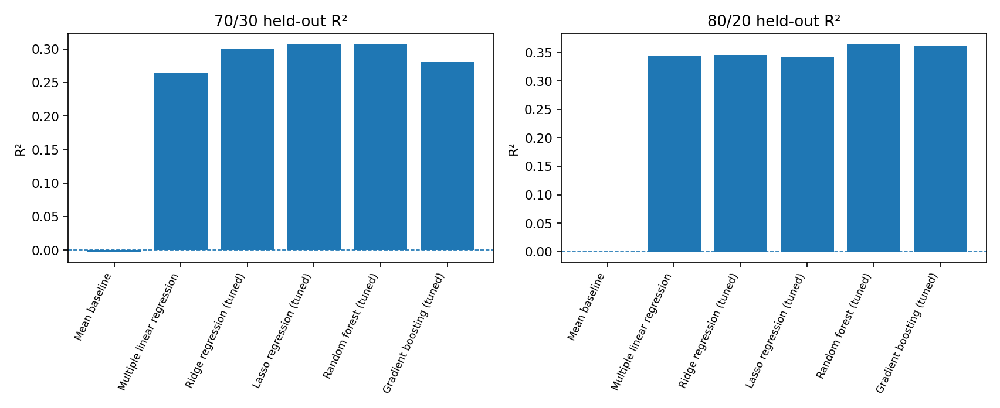
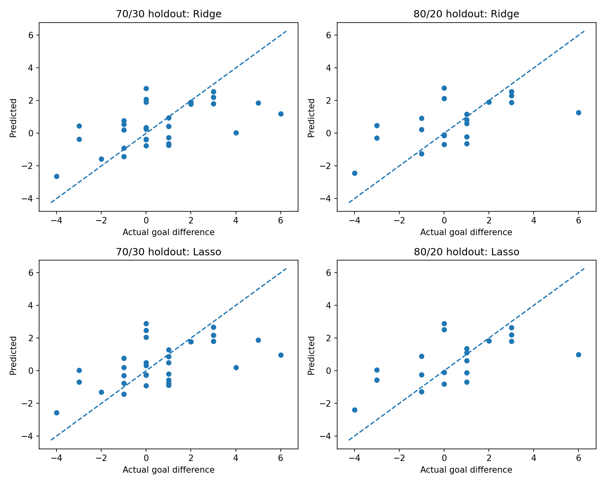
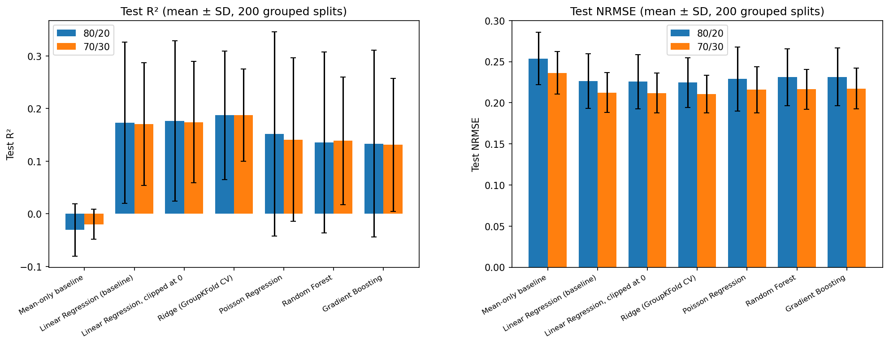
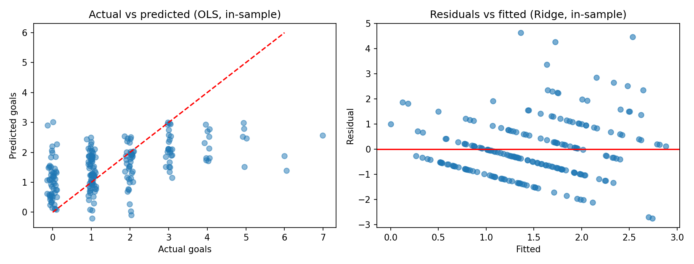
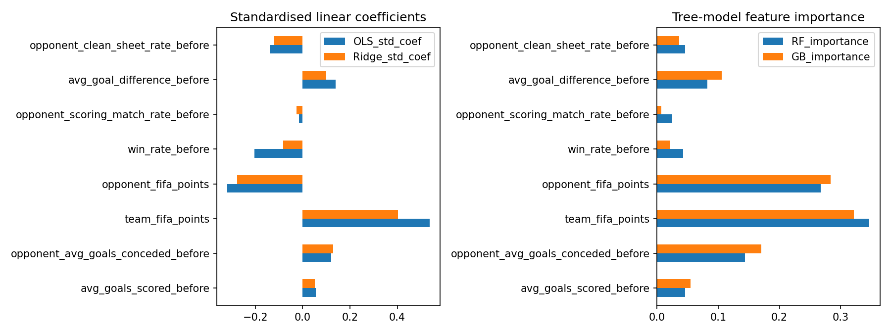

# HIT140 – Foundations of Data Science
## Assessment 3: FIFA World Cup 2026 Match Outcome Prediction Using Regression

**Charles Darwin University (CDU)**  
**Unit:** HIT140 – Foundations of Data Science  
**Assessment:** Assessment 3 – Group Project
**Submitted To:** Yakub Sebastian
**Submission date:** 15 October 2026  
**GitHub repository:** https://github.com/sauravsunuwar/Group_Assignment_03


---

## 1. Project Overview

This project investigates the application of regression techniques to predicting football match outcomes using FIFA World Cup 2026 data.

The analysis combines World Cup match records, FIFA world ranking points and historical international football results to develop pre-match performance indicators.

Two regression tasks were completed:

- **Regression 2.1:** Predict the goal difference between the two teams in a match.
- **Regression 2.2:** Predict the number of goals scored by an individual team.

The project includes data preparation, feature engineering, statistical modelling, model comparison, regression diagnostics and evaluation of predictive performance.

This README provides the complete technical documentation supporting the four-page assessment report. It also explains methodological details, diagnostic evidence and limitations that could not be fully discussed within the report's page limit.

## 2. Group Members and Contributions

| Member | Contribution |
|---|---|
| **Bibek Gurung** | Regression 2.1 modelling, diagnostics and results |
| **Anish Bhattarai** | Regression 2.2 modelling, diagnostics and results |
| **Swagata Dey Shuvo** | Contribution pending confirmation |
| **Saurab Kumar Sunuwar** | Data preparation, feature engineering, validation, documentation and GitHub integration |

Contributions are documented according to the work currently confirmed by the group.

## 3. Research Objectives

The project aims to:

1. Construct reliable datasets from football match and historical performance records.
2. Develop pre-match predictors representing team strength and recent performance.
3. Compare multiple regression approaches for two related prediction tasks.
4. Evaluate models using held-out observations and repeated data splits.
5. Examine regression assumptions, prediction errors and influential observations.
6. Identify limitations affecting predictive reliability and reproducibility.

## 4. Data Sources

### 4.1 FIFA World Cup 2026 Match Records

Match information was obtained using FIFA API endpoints.

The collected information includes match identifiers, competing teams, scores and other match-related details required to construct the master dataset.

**FIFA Calendar API:**

https://api.fifa.com/api/v3/calendar/matches?language=en&count=500&IdCompetition=17&IdSeason=285023

**FIFA Live API endpoint structure:**

https://api.fifa.com/api/v3/live/football/17/285023/{stage_id}/{match_id}?language=en

The master match dataset is stored as:

`data/data/world_cup_2026_master_matches.csv`

### 4.2 Historical International Results

Historical international football results were used to calculate performance indicators before the tournament.

The source data are stored in:

`data/data/international_results.csv`

These records support calculations of goals scored, goals conceded, win rate, scoring frequency and clean-sheet performance.

### 4.3 FIFA World Ranking Points

FIFA men's world ranking points dated 11 June 2026 were used to represent team strength.

The ranking dataset is stored in:

`data/data/fifa_rankings_11_june_2026.csv`

### 4.4 Supporting Data

The repository also contains additional football indicators, including pre-match Elo ratings and squad values.

These supporting datasets are available for exploratory analysis and future modelling. They should not be interpreted as inputs to the final regression models unless explicitly included in the corresponding final modelling scripts.

## 5. Dataset Preparation and Feature Engineering

### 5.1 Master Dataset

The project contains 104 World Cup matches involving 48 teams.

Two separate modelling datasets were constructed.

| Property | Regression 2.1 | Regression 2.2 |
|---|---|---|
| Unit of observation | One match | One team-match |
| Observations | 104 | 208 |
| Target | Goal difference | Goals scored |
| Predictors | 8 | 8 |
| Main purpose | Predict winning margin | Predict individual scoring |

Regression 2.2 contains two observations for each match because both participating teams are represented individually.

### 5.2 Historical Baselines

Pre-tournament baseline statistics were constructed using five eligible historical international matches for each participating team before 11 June 2026.

For 48 teams, this corresponds to 240 historical team-match records.

The resulting baseline features describe each team's recent performance before the tournament.

They include:

- Average goals scored.
- Average goals conceded.
- Win rate.
- Scoring-match rate.
- Clean-sheet rate.
- Average goal difference.

The supporting files include:

`data/data/pre_tournament_matches.csv`

`data/data/pre_tournament_baselines.csv`

### 5.3 Rolling Pre-Match Features

As the tournament progresses, previous tournament matches provide additional information about each team's performance.

The preprocessing workflow generates rolling statistics using prior matches.

These statistics are intended to represent information available before the match being predicted.

The generated feature dataset is stored in:

`data/data/world_cup_2026_team_prematch_features.csv`

This distinction is important because including information from the current match in its predictors would create direct target leakage.

### 5.4 Data Integrity and Validation

The preparation workflow includes checks relating to:

- Match identifier consistency.
- Team names and historical data matching.
- Missing values.
- Predictor construction.
- Dataset dimensions.
- Pre-match feature integrity.
- Regression input consistency.
- Multicollinearity.

Relevant validation scripts include:

`data/audit_prematch_integrity.py`

`data/check_regression_2_1_vif.py`

`data/check_regression_2_2_vif.py`

`data/cross_validate_regression_2_2.py`

`data/compare_regression_2_2.py`

The presence of validation scripts supports reproducibility, although successful execution and final outputs should be checked before submission.

---

## 6. Regression 2.1 – Goal Difference Prediction

**Contributor:** Bibek Gurung

### 6.1 Prediction Target

The target is calculated as:

**Goal difference = Home team goals − Away team goals**

A positive value represents a home-team winning margin, a negative value represents an away-team winning margin, and zero represents a draw.

### 6.2 Predictor Variables

Eight predictors were used:

| Predictor | Description |
|---|---|
| `fifa_points_difference` | Difference in FIFA ranking points |
| `points_per_match_difference` | Difference in points per match |
| `avg_goals_scored_difference` | Difference in average goals scored |
| `avg_goals_conceded_difference` | Difference in average goals conceded |
| `scoring_match_rate_difference` | Difference in scoring frequency |
| `scoring_consistency_difference` | Difference in scoring consistency |
| `clean_sheet_rate_difference` | Difference in clean-sheet frequency |
| `host_country_indicator` | Indicator for host-country involvement |

The difference-based features describe relative team strength rather than each team's statistics independently.

### 6.3 Models Evaluated

The analysis evaluates six modelling approaches:

1. Mean baseline.
2. Ordinary Least Squares (OLS).
3. Ridge regression.
4. Lasso regression.
5. Random Forest regression.
6. Gradient Boosting regression.

The mean baseline provides a reference prediction.

OLS estimates linear relationships between predictors and goal difference.

Ridge and Lasso introduce regularisation to reduce model complexity.

Random Forest and Gradient Boosting allow nonlinear relationships and interactions between predictors.

### 6.4 Evaluation Method

The modelling workflow uses two train/test proportions:

- 70% training and 30% testing.
- 80% training and 20% testing.

The analysis uses 200 repeated random splits to assess the stability of model performance.

Evaluation metrics include:

| Metric | Interpretation |
|---|---|
| R² | Proportion of outcome variation explained on the evaluated data |
| RMSE | Root mean squared prediction error |
| MAE | Mean absolute prediction error |
| NRMSE | Normalised root mean squared error |

Lower error metrics and higher held-out R² generally indicate stronger predictive performance.

### 6.5 Final Authoritative Files

The final Regression 2.1 version is stored at:

[Regression 2.1 – Final Updated 2026](https://github.com/sauravsunuwar/Group_Assignment_03/tree/main/Regression_2_1_Bibek/final_updated_2026)

The folder contains:

- `Regression_2_1_Updated_Validated_Report.docx`
- `regression_2_1_dataset_latest.csv`
- `regression_2_1_modeling_reviewed.py`
- `README.md`
- `results_latest/`
- `source_evidence/`

**Version control note:** The latest model run supersedes the previous reviewed results. Model-performance figures in the final group report must be taken from the updated results, not from an earlier version.

### 6.6 Results and Visualisations

The authoritative outputs are stored in:

[Regression 2.1 – Latest Results](https://github.com/sauravsunuwar/Group_Assignment_03/tree/main/Regression_2_1_Bibek/final_updated_2026/results_latest)

These outputs document model comparisons, coefficients, prediction errors and regression diagnostics.

The latest result files should be used when reporting numerical model performance.

### 6.7 Diagnostic Considerations

Regression 2.1 includes statistical checks concerning:

- Residual normality.
- Heteroscedasticity.
- Influential observations.
- Predictor correlations.
- Coefficient stability.
- Model performance across different data splits.

These tests are important because predictive accuracy and statistical inference are different objectives.

A model may predict reasonably well while still violating assumptions relevant to coefficient interpretation.

---

## 7. Regression 2.2 – Team Goals Scored Prediction

**Contributor:** Anish Bhattarai

### 7.1 Prediction Target

Regression 2.2 predicts the number of goals scored by an individual team in a match.

Each of the 104 matches contributes two team-match observations, producing a dataset of 208 rows.

### 7.2 Predictor Variables

Eight predictors were used:

| Predictor | Description |
|---|---|
| `avg_goals_scored_before` | Team's average goals scored before the match |
| `opponent_avg_goals_conceded_before` | Opponent's average goals conceded |
| `team_fifa_points` | Team's FIFA ranking points |
| `opponent_fifa_points` | Opponent's FIFA ranking points |
| `win_rate_before` | Team's previous win rate |
| `opponent_scoring_match_rate_before` | Opponent's previous scoring frequency |
| `avg_goal_difference_before` | Team's previous average goal difference |
| `opponent_clean_sheet_rate_before` | Opponent's previous clean-sheet rate |

### 7.3 Models Evaluated

Seven approaches were evaluated:

1. Mean baseline.
2. Ordinary Least Squares.
3. Clipped OLS.
4. Ridge regression.
5. Poisson regression.
6. Random Forest regression.
7. Gradient Boosting regression.

Clipped OLS prevents negative goal-count predictions.

Poisson regression is a relevant candidate because goals scored are nonnegative count outcomes.

Ridge regression applies regularisation, while tree-based models can represent nonlinear relationships.

### 7.4 Match-Level Grouped Evaluation

The two team observations from a single match are related.

To avoid placing opposite sides of the same match into different training and testing sets, the evaluation groups observations by `match_id`.

The workflow includes:

- GroupShuffleSplit.
- 200 repeated splits.
- 70/30 and 80/20 train/test proportions.
- GroupKFold-based cross-validation for Ridge tuning.

This approach reduces within-match splitting problems.

However, it does not completely eliminate temporal leakage when earlier and later tournament matches are mixed across training and testing sets.

### 7.5 Previously Reported Model Performance

The following figures are from the previously reviewed Regression 2.2 analysis. They must be checked against the final notebook and results before being treated as the authoritative final values.

| Model | Mean Test R² – 70/30 | Mean Test R² – 80/20 |
|---|---:|---:|
| Mean baseline | -0.0197 | -0.0305 |
| OLS | 0.1705 | 0.1732 |
| Clipped OLS | 0.1744 | 0.1768 |
| Ridge | **0.1878** | **0.1873** |
| Poisson | 0.1413 | 0.1519 |
| Random Forest | 0.1387 | 0.1360 |
| Gradient Boosting | 0.1311 | 0.1333 |

In this reviewed evaluation, Ridge achieved the highest mean test R².

Previously reported Ridge error metrics:

| Metric | 70/30 | 80/20 |
|---|---:|---:|
| RMSE | 1.2336 | 1.2353 |
| MAE | 0.9398 | 0.9433 |
| NRMSE | 0.2105 | 0.2246 |

The relatively modest R² values indicate that substantial variation in match scoring remains unexplained.

### 7.6 Regression Diagnostics

Previously reported OLS diagnostic findings include:

| Diagnostic | Result |
|---|---|
| Shapiro–Wilk | p = 0.000005375 |
| Jarque–Bera | p = 7.458 × 10⁻¹³ |
| Breusch–Pagan | p = 0.0332 |
| White test | p = 0.1204 |
| Cook's distance | 11 influential observations flagged |

The normality tests suggest that the OLS residuals depart from a normal distribution.

The Breusch–Pagan test suggests possible heteroscedasticity, while the White test provides less evidence at the conventional 5% significance level.

The influential observations indicate that unusual match outcomes may affect fitted coefficients.

These findings should be interpreted cautiously and checked against the final diagnostic outputs.

### 7.7 Final Files

The final Regression 2.2 analysis is available at:

[Regression 2.2 – Final Notebook and Dataset](https://github.com/sauravsunuwar/Group_Assignment_03/tree/main/Regression_2.2)

The folder contains:

- `Regression_2_2_Final_Improved.ipynb`
- `regression_2_2_dataset.csv`
- `results_2_2/`

The final results are available at:

[Regression 2.2 – Results](https://github.com/sauravsunuwar/Group_Assignment_03/tree/main/Regression_2.2/results_2_2)

These include:

- Model comparison.
- Actual versus predicted values.
- Residual diagnostics.
- Feature importance.
- Feature-target correlations.
- Gradient Boosting tuning comparison.
- OLS match-cluster robust inference.
- Repeated-split results.
- Held-out Ridge predictions.

---

## 8. Model Visualisations

The repository includes visualisations generated by the regression analyses.

### 8.1 Regression 2.1: Model Comparison

The following figure compares model performance using R².



### 8.2 Regression 2.1: Actual Versus Predicted

This graph illustrates the relationship between observed goal differences and model predictions.



### 8.3 Regression 2.2: Model Comparison

This graph compares the performance of the evaluated models for predicting goals scored.



### 8.4 Regression 2.2: Actual Versus Predicted and Residuals

This figure supports interpretation of Ridge prediction accuracy and residual behaviour.



### 8.5 Regression 2.2: Feature Importance

The feature-importance graph provides a model-specific indication of which predictors contribute most strongly to the fitted analysis.



**Note:** These are relative GitHub image paths. Confirm that the Regression 2.1 filenames match the files inside `results_latest/`. The Regression 2.2 filenames are visible in the final repository screenshots.

---

## 9. Additional Methodological Discussion

The following sections expand on topics that could not be discussed fully within the four-page report.

### 9.1 Difference Between the Two Regression Tasks

Regression 2.1 predicts the difference between two teams' goals.

Regression 2.2 predicts each team's goal count separately.

Although the tasks are related, their performance metrics are not directly interchangeable.

The targets have different statistical distributions, and the datasets have different units of observation.

Therefore, a higher R² in one task does not necessarily mean that its model is more useful than a model developed for the other task.

### 9.2 Why Multiple Models Were Compared

Different regression models make different assumptions.

Linear models assume additive relationships between predictors and the expected outcome.

Regularised models reduce coefficient complexity.

Tree-based models can capture nonlinear patterns.

Poisson regression provides an approach specifically suited to count outcomes.

Comparing multiple models helps determine whether a more complex method provides meaningful predictive improvement.

### 9.3 Why Repeated Splits Matter

A single train/test split can produce results that depend strongly on which observations enter each set.

Repeated evaluation provides a broader picture of performance stability.

However, averaging across 200 splits does not guarantee that the model will perform equally well on genuinely future matches.

### 9.4 Multicollinearity

Football performance indicators may be strongly related.

For example, teams with high FIFA ranking points may also have stronger win rates and average goal differences.

These relationships can make individual linear regression coefficients difficult to interpret.

Variance Inflation Factor analysis can help identify multicollinearity.

Ridge regression may reduce instability associated with correlated predictors.

### 9.5 Residual Normality

Residual normality is relevant to some forms of statistical inference in linear regression.

It is not a requirement that the target variable itself be normally distributed.

If residual normality assumptions are not satisfied, conventional significance tests and confidence intervals may require additional caution.

### 9.6 Heteroscedasticity

Heteroscedasticity occurs when prediction-error variance is not constant across observations.

This may affect conventional OLS standard errors.

Possible responses include robust standard errors or alternative modelling approaches.

### 9.7 Influential Observations

Football datasets may contain unusual results, such as unexpected victories or large scoring margins.

These observations can influence fitted models.

Cook's distance is one diagnostic method used to identify potentially influential observations.

Such observations should not be removed automatically because they may represent genuine football outcomes.

### 9.8 Temporal Data Leakage

Temporal leakage is a significant methodological limitation.

The project constructs pre-match features using earlier results. However, random train/test splitting can place later tournament observations in the training set and earlier observations in the test set.

A later training observation may contain rolling statistics derived from an earlier test match.

This means the repeated-split evaluation may not fully represent a realistic future-match prediction scenario.

A stronger prospective evaluation would use chronological splitting, where all training information precedes the matches being predicted.

### 9.9 Limited Sample Size

Regression 2.1 uses 104 matches.

Regression 2.2 uses 208 team-match observations, but these represent only 104 underlying matches.

This limits the amount of independent information available for model development.

Small datasets can make complex models more sensitive to unusual observations and training/test selection.

### 9.10 Dataset Version Control

Multiple dataset versions were produced during preprocessing, review and correction.

Some versions contain the same match identifiers and goals but differ in pre-match predictor calculations.

Such differences may change model coefficients, tuning decisions and performance metrics.

For reproducibility, final results must be associated with the exact dataset and code version that generated them.

In particular:

- Use Regression 2.1's `final_updated_2026` dataset and results together.
- Use Regression 2.2's final dataset and notebook together.
- Do not combine old results with newly corrected predictor values.
- Re-run the model if its input dataset is replaced.

### 9.11 Prediction Versus Causation

The regression analyses identify statistical relationships between team characteristics and match outcomes.

They do not establish that a particular feature directly causes a team to score more goals or win.

For example, FIFA ranking points represent an indicator of team strength rather than a direct causal mechanism.

Model coefficients and feature importance should therefore be interpreted as associations.

### 9.12 Future Improvements

Future work could strengthen the project by:

- Using chronological evaluation.
- Including more historical tournaments.
- Investigating alternative count-data models.
- Incorporating team injuries, line-ups and tactical information.
- Examining prediction uncertainty.
- Comparing model calibration and error distributions.
- Testing generalisation to other international competitions.

---

## 10. Repository Structure

The final repository is organised as follows:

```text
Group_Assignment_03/
│
├── README.md
├── .gitignore
│
├── Regression_2_1_Bibek/
│   └── final_updated_2026/
│       ├── README.md
│       ├── Regression_2_1_Updated_Validated_Report.docx
│       ├── regression_2_1_dataset_latest.csv
│       ├── regression_2_1_modeling_reviewed.py
│       ├── results_latest/
│       └── source_evidence/
│
├── Regression_2.2/
│   ├── Regression_2_2_Final_Improved.ipynb
│   ├── regression_2_2_dataset.csv
│   └── results_2_2/
│
└── data/
    ├── data/
    │   ├── fifa_rankings_11_june_2026.csv
    │   ├── international_results.csv
    │   ├── pre_tournament_baselines.csv
    │   ├── pre_tournament_matches.csv
    │   ├── regression_2_1_dataset.csv
    │   ├── regression_2_2_dataset.csv
    │   ├── world_cup_2026_master_matches.csv
    │   ├── world_cup_2026_prematch_elo.csv
    │   ├── world_cup_2026_squad_values.csv
    │   └── world_cup_2026_team_prematch_features.csv
    │
    ├── build_master_database.py
    ├── build_pretournament_match_data.py
    ├── build_pretournament_baseline.py
    ├── build_prematch_features.py
    ├── build_regression_2_1_dataset.py
    ├── build_regression_2_2_dataset.py
    ├── audit_prematch_integrity.py
    ├── check_regression_2_1_vif.py
    ├── check_regression_2_2_vif.py
    └── additional preparation and validation scripts
```

## 11. Reproducibility

### 11.1 Software

The project uses Python and Jupyter Notebook.

Relevant libraries include:

- pandas
- numpy
- scikit-learn
- scipy
- statsmodels
- matplotlib
- seaborn

The exact dependencies should be confirmed against the imports in the final scripts.

### 11.2 Running the Analysis

Clone the repository:

```bash
git clone https://github.com/sauravsunuwar/Group_Assignment_03.git
cd Group_Assignment_03
```

Install the required Python packages in an appropriate environment.

For Regression 2.1, use the latest dataset and modelling script in:

`Regression_2_1_Bibek/final_updated_2026/`

For Regression 2.2, open the final notebook:

`Regression_2.2/Regression_2_2_Final_Improved.ipynb`

Run the notebook using its corresponding dataset.

The results should be compared with the committed outputs in each regression's final results directory.

Some scripts may require adjustment of local file paths or execution from the relevant folder.

## 12. Limitations

The project has several limitations:

- The number of tournament matches is relatively small.
- Football outcomes contain substantial randomness.
- Some predictors are correlated.
- Certain regression assumptions may not hold.
- Unusual match results can influence model estimates.
- Repeated random splits do not fully eliminate temporal leakage.
- Historical performance may not capture injuries, tactics or changing team composition.
- Results may not generalise to future tournaments.
- Dataset corrections and version changes require careful tracking.

These limitations mean that the models should be interpreted as exploratory predictive analyses rather than guaranteed forecasts.

## 13. Conclusion

This project demonstrates how regression methods can be applied to football match data to investigate goal difference and individual team scoring.

Regression 2.1 and Regression 2.2 provide complementary perspectives on match outcomes.

The analysis shows the importance of constructing appropriate pre-match predictors, comparing multiple models, evaluating held-out performance and checking regression assumptions.

The results also highlight the difficulty of predicting football outcomes from a relatively small dataset.

The complete GitHub repository provides the datasets, code, visualisations and diagnostic outputs supporting the assessment report.

## 14. References and Supporting Resources

**FIFA:** https://www.fifa.com/

**FIFA World Rankings:** https://inside.fifa.com/fifa-world-ranking/men

**FIFA Calendar API:** https://api.fifa.com/api/v3/calendar/matches?language=en&count=500&IdCompetition=17&IdSeason=285023

**scikit-learn documentation:** https://scikit-learn.org/stable/

**statsmodels documentation:** https://www.statsmodels.org/

**pandas documentation:** https://pandas.pydata.org/docs/

**Project GitHub repository:** https://github.com/sauravsunuwar/Group_Assignment_03

---

*Prepared for HIT140 Foundations of Data Science – Assessment 3, October 2026.*
